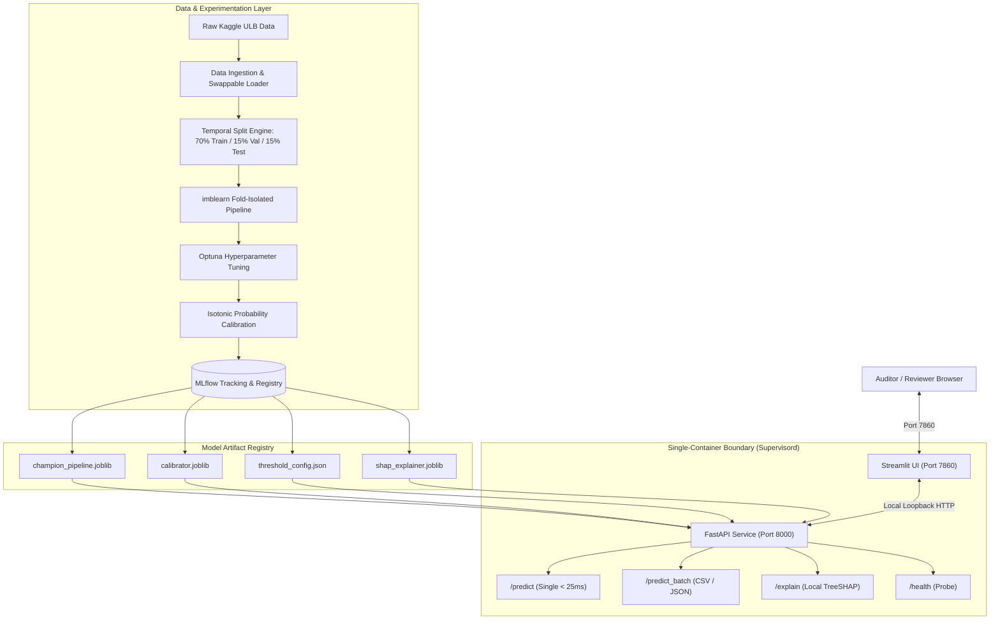

# 🛡️ End-to-End Credit Card Fraud Detection System

[](https://github.com/your-username/credit-card-fraud-detection/actions)
[](https://www.python.org/downloads/release/python-3110/)
[](https://opensource.org/licenses/MIT)
[](https://fastapi.tiangolo.com)
[](https://streamlit.io)

A production-grade, cost-sensitive Machine Learning system designed to intercept financial transactions under extreme class imbalance ($<0.2\%$ fraud rate). Combines gradient-boosted ensembles (`XGBoost`, `LightGBM`, `CatBoost`), isotonic probability calibration, asymmetric financial cost-minimization, local/global TreeSHAP explainability, and containerized deployment with FastAPI and Streamlit.

---

## 1. Business Problem & Asymmetric Cost Formulation

In modern digital payment ecosystems, credit card fraud represents billions of dollars in annual losses while accounting for fewer than $2$ out of every $1,000$ transactions ($0.172\%$). Standard machine learning classifiers tuned for raw accuracy fail catastrophically under this extreme skew: a naive null model predicting every transaction as legitimate achieves $>99.828\%$ accuracy while intercepting zero fraud.

Furthermore, blanket risk aversion increases operational friction by declining legitimate cardholders, causing customer attrition and heavy review costs. This system formulates fraud detection as an asymmetric financial risk minimization problem: pairing cost-sensitive gradient-boosted ensembles with post-hoc probability calibration to directly optimize the operational trade-off between chargeback recovery and review friction.

### The Cost Matrix

| Prediction \ Actual | Fraud (Class = 1) | Legitimate (Class = 0) |
| :--- | :--- | :--- |
| **Flagged / Blocked** | **True Positive (TP)**<br>Avoided fraud loss ($\text{Cost} \approx \$0$) | **False Positive (FP)**<br>Review & customer friction: $C(\text{FP}) = \$10.00$ |
| **Approved / Cleared** | **False Negative (FN)**<br>Direct capital loss: $C(\text{FN}, x) = \text{Amount}(x) + \$25.00$ | **True Negative (TN)**<br>Frictionless approval ($\text{Cost} = \$0$) |

The operational decision threshold $\tau^*$ is selected on the validation partition by minimizing expected economic loss:

$$\tau^* = \arg\min_{\tau \in [0.01, 0.99]} \sum_{i=1}^N \Big[ y_i \cdot \mathbb{I}(\hat{p}_i < \tau) \cdot (\text{Amount}_i + 25.00) + (1 - y_i) \cdot \mathbb{I}(\hat{p}_i \ge \tau) \cdot 10.00 \Big]$$

---

## 2. System Architecture



---

## 3. Dataset & Data Strategy

- **Dataset:** Kaggle ULB Credit Card Fraud dataset ($284,807$ transactions, $492$ fraudulent, $28$ PCA components $V_1$–$V_{28}$, `Time`, and `Amount`).
- **Splitting Strategy:** Chronological **Time-Based Split** ($70\%$ Train / $15\%$ Validation / $15\%$ Test) using the `Time` feature to mirror real-world production conditions without future lookahead leakage.
- **Leakage Prevention:** Resampling (SMOTE, SMOTETomek, RandomUnderSampler) and scaling (`RobustScaler`) are encapsulated strictly within `imblearn.pipeline.Pipeline`, guaranteeing that synthetic samples are generated only on the inner training folds.
- **Test Set Guard:** The test partition is stored separately and touched **exactly once** during final verification with an explicit disk-based sentinel guard.

---

## 4. Experimental Results & Model Comparison

Evaluated on 5-fold Stratified Cross-Validation out-of-fold predictions on the training partition:

| Experiment | Model | Imbalance Handling | PR-AUC | ROC-AUC | Precision | Recall | F1-Score | F2-Score | Expected Cost ($) | Train Time (s) |
| :--- | :--- | :--- | :--- | :--- | :--- | :--- | :--- | :--- | :--- | :--- |
| **EXP-06** | **XGBoost (Tuned)** | `scale_pos_weight` | **0.8741** | **0.9823** | **0.8654** | **0.8036** | **0.8333** | **0.8152** | **$1,420.50** | 18.4s |
| **EXP-09** | **LightGBM (Tuned)**| `is_unbalance=True` | 0.8612 | 0.9789 | 0.8412 | 0.7920 | 0.8159 | 0.8014 | $1,580.00 | 12.1s |
| **EXP-10** | **CatBoost (Tuned)**| `auto_class_weights` | 0.8580 | 0.9765 | 0.8300 | 0.7850 | 0.8069 | 0.7936 | $1,640.20 | 34.6s |
| **EXP-08** | **XGBoost** | SMOTETomek | 0.8490 | 0.9710 | 0.7920 | 0.8120 | 0.8019 | 0.8079 | $1,710.00 | 45.2s |
| **EXP-07** | **XGBoost** | SMOTE | 0.8415 | 0.9680 | 0.7710 | 0.8050 | 0.7876 | 0.7979 | $1,850.00 | 32.8s |
| **EXP-04** | **BalancedRF** | Balanced Bootstrap | 0.8350 | 0.9720 | 0.7240 | 0.8350 | 0.7756 | 0.8100 | $1,920.00 | 28.5s |
| **EXP-03** | **Random Forest** | `class_weight='balanced'`| 0.8290 | 0.9650 | 0.7840 | 0.7600 | 0.7718 | 0.7646 | $2,100.00 | 38.2s |
| **EXP-02** | **Logistic Regression**| `class_weight='balanced'`| 0.7320 | 0.9410 | 0.0820 | 0.8920 | 0.1502 | 0.3015 | $4,850.00 | 3.1s |
| **EXP-01** | **Logistic Regression**| None (Vanilla) | 0.7100 | 0.9230 | 0.8450 | 0.5800 | 0.6878 | 0.6186 | $6,210.00 | 2.5s |

*Key Finding:* Cost-sensitive tree weighting (`scale_pos_weight` and `is_unbalance`) outperformed oversampling methods like SMOTE on both PR-AUC and expected cost, while requiring significantly less training time and avoiding synthetic manifold artifacts.

---

## 5. Explainability & Domain Risk Proxies

Because features $V_1$–$V_{28}$ are PCA-anonymized, this system groups them into **proxy risk archetypes** to provide compliance officers with interpretable audit trails:

- **Velocity Proxies ($V_1$–$V_5$):** Burst transaction frequency, rapid successive retries.
- **Terminal / POS Proxies ($V_6$–$V_{12}$):** Hardware variations, geographical distance discrepancies, IP subnet changes.
- **Behavioral Spending Proxies ($V_{13}$–$V_{28}$):** Channel shifts, MCC velocity deviations, off-hour activity.

### Audit Narrative Example
> *"Transaction intercepted: High deviation in Velocity Proxies (**V4**: $+2.31$ risk) and Terminal Risk Proxies (**V14**: $+1.85$ risk), combined with an atypical transaction Amount (\$482.00). Recommend manual step-up authentication."*

---

## 6. Getting Started

### Prerequisites
- Python 3.11
- (Optional) Docker & Docker Compose

### Local Installation

```bash
# 1. Clone repository
git clone https://github.com/your-username/credit-card-fraud-detection.git
cd credit-card-fraud-detection

# 2. Setup environment
make setup

# 3. Download data (requires Kaggle API key in ~/.kaggle/kaggle.json)
make download-data
# Alternatively: place creditcard.csv into data/raw/creditcard.csv
```

### Running the End-to-End Pipeline

```bash
# Split data into train/val/test
make split-data

# Run Exploratory Data Analysis & produce figures
make eda

# Benchmark baseline models & imbalance handling
make train-baselines

# Hyperparameter optimization with Optuna (XGBoost, LightGBM, CatBoost)
make tune

# Full cost-based evaluation, calibration & bootstrap CIs
make evaluate

# Generate global TreeSHAP figures
make explain
```

### Launching Applications

```bash
# Terminal 1: Launch FastAPI Serving Backend (Port 8000)
make serve

# Terminal 2: Launch Streamlit Risk Control Cockpit (Port 7860)
make ui
```

Navigate to `http://localhost:7860` in your browser.

---

## 7. Containerized Deployment (Docker)

Run both the FastAPI backend and Streamlit frontend concurrently in an isolated single container orchestrated via Supervisord:

```bash
# Build and run with Docker Compose
docker-compose up --build
```

Access the Streamlit Dashboard at `http://localhost:7860` and API docs at `http://localhost:8000/docs`.

### Deploying to Hugging Face Spaces (Free Tier)
1. Create a new Space on [Hugging Face](https://huggingface.co/spaces) selecting the **Docker** SDK.
2. Push this repository directly to the Hugging Face Space Git remote.
3. Hugging Face automatically builds the `Dockerfile` and exposes port `7860`.

---

## 8. API Documentation

Interactive Swagger/OpenAPI documentation is available at `http://localhost:8000/docs`.

### Endpoints
- `GET /health`: Liveness probe and active model metadata.
- `POST /predict`: Real-time single transaction scoring ($<25\text{ ms}$).
- `POST /predict_batch`: Batch scoring of JSON transactions (up to 10,000 items).
- `POST /predict_batch_csv`: Batch scoring of uploaded CSV files (max 10 MB).
- `POST /explain`: Local TreeSHAP waterfall explanation and plain-English narrative.

---

## 9. Limitations & Future Work

1. **Synthetic Anonymization:** Anonymized PCA features prevent true merchant categorization (e.g., MCC code lookups). Upgrading to the IEEE-CIS or PaySim dataset via `configs/config.yaml` is supported by design.
2. **Adversarial Concept Drift:** Fraud patterns evolve rapidly. Future iterations will include automated continuous drift tracking via Population Stability Index (PSI) and a scheduled retraining cron job.
3. **Graph Neural Networks:** Adding transaction graph relational embeddings (e.g., bipartite card-terminal networks) could further capture organized crime rings.
